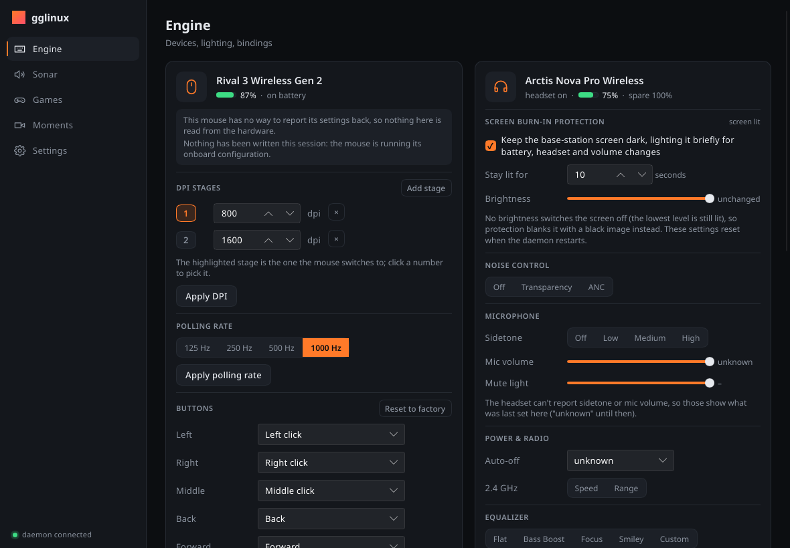
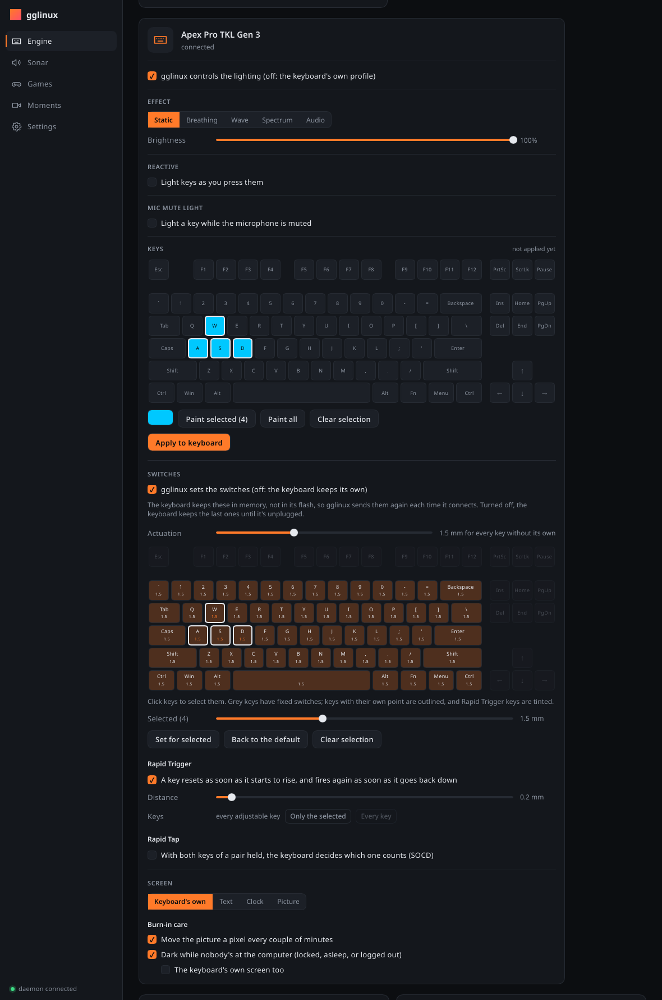
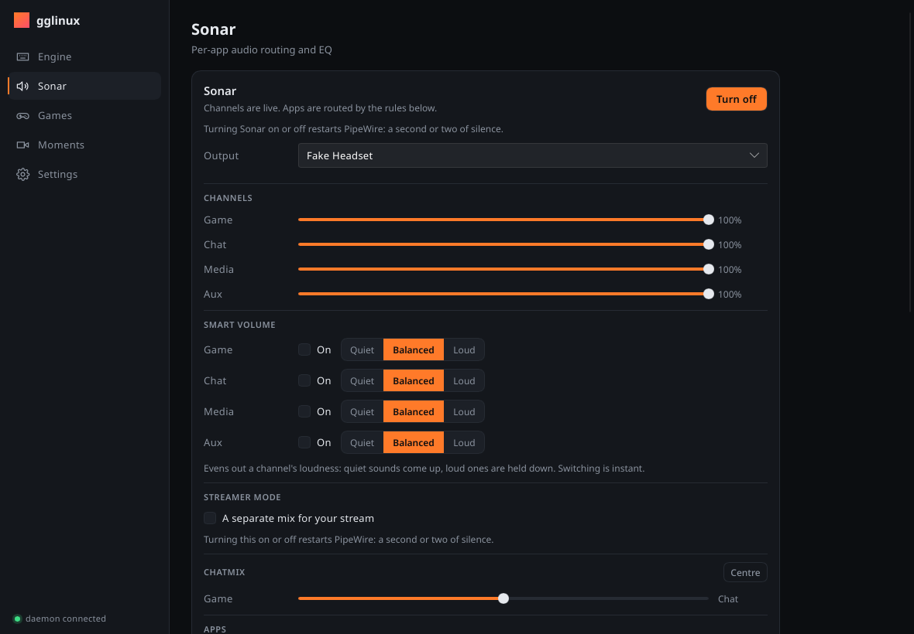
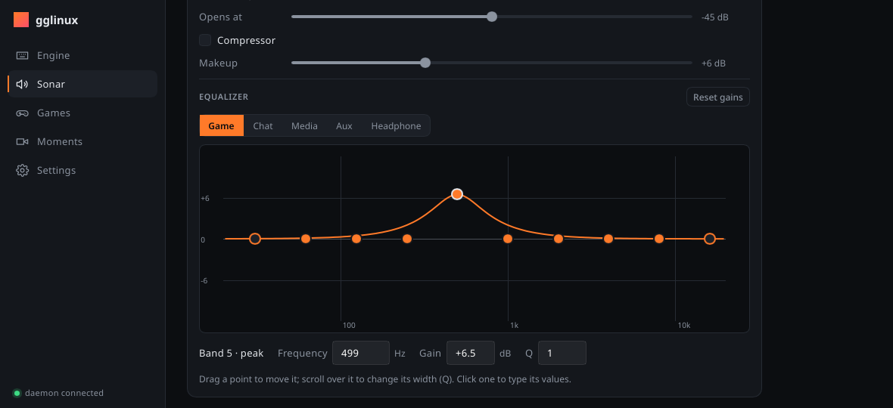
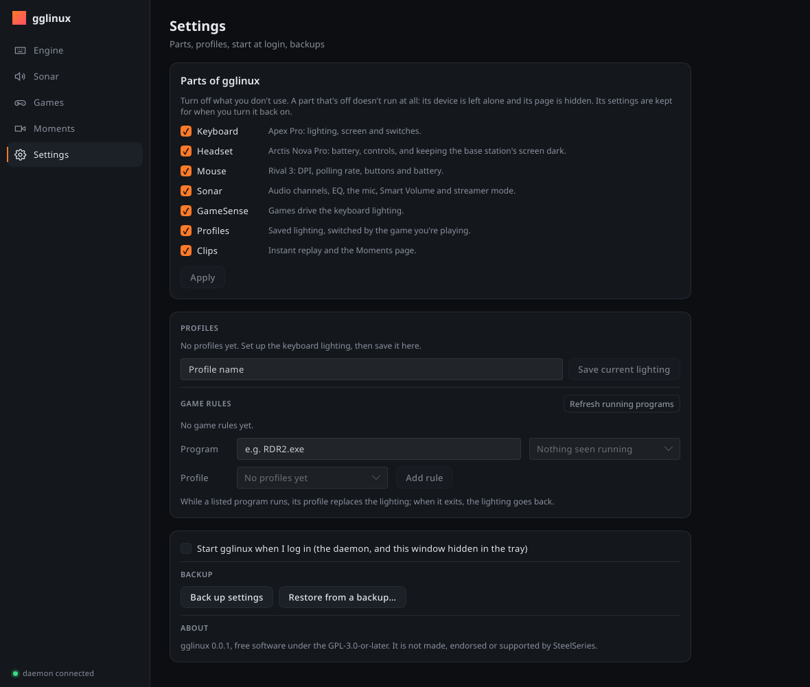
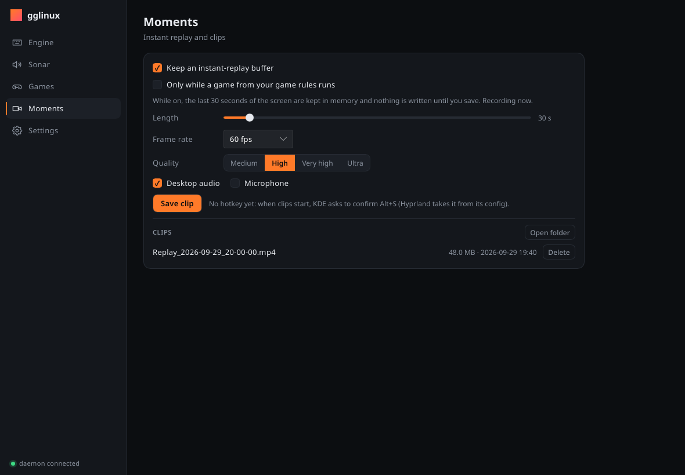

# gglinux

An open-source replacement for **SteelSeries GG** on Linux. SteelSeries only ships GG for Windows
and macOS. On Linux their keyboards, headsets and mice work as plain USB devices, and their
settings are out of reach except through separate single-device tools. gglinux brings back the
parts of GG that matter for the devices it supports: device control (GG's Engine), a Sonar-style
audio mixer on PipeWire, GameSense lighting for games, and instant-replay clips (GG's Moments).

It is a Rust daemon, `gglinuxd`, that does all the device and audio work, a small CLI, `ggctl`,
and a native desktop app, `gglinux`, written in Rust with [Slint](https://slint.dev). Licensed
GPL-3.0-or-later.

> gglinux is an independent project. It is not made, endorsed or supported by SteelSeries.
> "SteelSeries", "GG", "Sonar", "Moments" and "GameSense" are SteelSeries trademarks, used here only
> to say what gglinux is compatible with.

## Project status: early, mostly untested on hardware

Read this before you plug anything in. gglinux has one developer and one set of devices. Almost
everything is built and covered by unit tests against fake devices and a fake PipeWire, but only
two features have been confirmed working on real hardware:

- **Keyboard lighting** on the Apex Pro TKL Gen 3: static per-key colours, the wave effect, and
  handing lighting back to the keyboard's own onboard effects.
- **Base-station screen protection** on the Arctis Nova Pro Wireless: the base station's OLED is
  kept dark (it never sleeps on its own) and lit briefly on real events such as a battery change.

Read-only paths, such as listing the connected devices and reading headset status and battery,
were also seen working during development. **Everything else below is untested on hardware.**
Expect bugs, and please report them.

### Supported devices

| Device | USB ID | Status |
|---|---|---|
| Apex Pro TKL Gen 3 (keyboard) | `1038:1642` | Lighting verified. Screen and switches untested. |
| Arctis Nova Pro Wireless (headset + base station) | `1038:12e0` | Screen protection verified. Controls untested. |
| Rival 3 Wireless Gen 2 (mouse) | `1038:1872` | Parked: built, never confirmed on hardware. |

Other SteelSeries devices are not supported. Each device speaks its own protocol, and gglinux only
talks to the exact USB IDs above.

### Feature matrix

**Verified** means seen working on real hardware. **Untested** means built and unit-tested, not yet
tried on hardware. **Blocked** means it cannot be built yet. **Parked** means built, but the hardware
is no longer available to test it.

| Area | Feature | Status |
|---|---|---|
| Keyboard | Per-key static colours, wave effect, hand-back to onboard lighting | Verified |
| Keyboard | Breathing and spectrum effects | Untested |
| Keyboard | Reactive lighting (Fade, Ripple on key press), opt-in | Untested |
| Keyboard | OLED screen: text, clock, a picture | Untested |
| Keyboard | Screen burn-in care: the picture moves a pixel now and then, and goes dark while you're away | Untested |
| Keyboard | Actuation point (global and per key), Rapid Trigger, Rapid Tap | Untested |
| Keyboard | Key remap, second actuation point, saving to the keyboard's flash | Not built |
| Headset | Base-station screen burn-in protection | Verified |
| Headset | ANC, transparency, sidetone, mic volume and mute light, auto-off, 2.4 GHz mode, on-device EQ | Untested |
| Mouse | DPI stages, polling rate, button remap, onboard save | Parked |
| Sonar audio | Game, Chat, Media and Aux channels, per-app routing, ChatMix slider | Untested |
| Sonar audio | 10-band EQ per channel, headphone correction, AutoEQ import | Untested |
| Sonar audio | Virtual mic: RNNoise noise suppression, gate, compressor | Untested |
| Sonar audio | Smart Volume, streamer mode (a separate mix for OBS) | Untested |
| GameSense | Local GameSense server, game events drawn on the keyboard, Proton support | Untested |
| GameSense | Built-in audio visualizer and mic-mute light | Untested |
| Profiles | Named lighting profiles, switched automatically per game | Untested |
| Moments | Instant-replay clips through gpu-screen-recorder, hotkey, clip library | Untested |
| Desktop | Tray, start at login, settings backup and restore, `ggctl` | Untested |
| Desktop | Turn any part off (keyboard, headset, mouse, Sonar, GameSense, profiles, clips) | Untested |

The full parity checklist against GG, with the reasons behind each status, is in
[PLAN.md](PLAN.md#feature-parity-checklist-vs-steelseries-gg).

### Screenshots

Drawn by the app itself against the fake daemon, with no display (`./scripts/screenshots.sh`, see
[CONTRIBUTING.md](CONTRIBUTING.md#pictures-of-the-app-without-a-screen)), so the devices and values
are made up.

| | |
|---|---|
|  |  |
|  |  |
|  |  |

## How it works

- `gglinuxd` runs as a `systemd --user` service. It opens the devices' HID control interfaces,
  drives PipeWire through its own command-line tools (`pw-dump`, `pw-cli`, `pw-metadata`, `wpctl`),
  serves GameSense on `127.0.0.1`, and supervises `gpu-screen-recorder` for clips.
- The desktop app and `ggctl` are clients. They talk to the daemon over a unix socket in
  `$XDG_RUNTIME_DIR/gglinux/` using JSON-RPC. Closing the app leaves the daemon applying your
  settings.
- Nothing runs as root. A udev rule gives the logged-in desktop user access to the few HID
  interfaces gglinux needs.

More detail in [docs/ARCHITECTURE.md](docs/ARCHITECTURE.md). The byte-level device protocols are in
[docs/PROTOCOLS.md](docs/PROTOCOLS.md).

## Requirements

- Linux with systemd (for the user service and logind's device ACLs).
- PipeWire 1.0 or newer with WirePlumber 0.5, for Sonar and the audio-driven effects.
- To build: Rust 1.87 or newer for the daemon, 1.92 or newer for the desktop app (Slint 1.18 needs
  it).
- Build libraries: `libudev` headers and `pkg-config` for the daemon, fontconfig for the app.
- To run the app: a Wayland or X11 session with OpenGL (EGL), which any Mesa or NVIDIA driver
  provides. Its tray icon needs a tray that speaks StatusNotifierItem: Plasma's, or Waybar's `tray`
  module on Hyprland.

On **Arch Linux**:

```sh
sudo pacman -S --needed base-devel rust fontconfig
```

On **Debian or Ubuntu** (tested on Ubuntu 24.04, which is also what CI uses):

```sh
sudo apt install build-essential pkg-config libudev-dev libfontconfig-dev
```

Rust from [rustup](https://rustup.rs) is the easiest way to get a new enough toolchain on Debian
and Ubuntu.

Optional packages turn on more features. gglinux works without them and tells you in the app what
is missing:

| Package (Arch name) | Used for | Without it |
|---|---|---|
| `noise-suppression-for-voice` | RNNoise noise suppression in the virtual mic | no virtual mic |
| `swh-plugins` | the `sc4m` compressor (virtual mic and Smart Volume) | no virtual mic, no Smart Volume |
| `gpu-screen-recorder` | instant-replay clips | the Moments page asks you to install it |
| `xdg-desktop-portal` with a backend (KDE, GNOME, Hyprland, ...) | the clip hotkey, screen capture, and the app's file dialogs (keyboard picture, restoring a backup) | no clip hotkey or portal screen capture; the app can't open files |

## Install

### Arch Linux

A `gglinux-git` PKGBUILD is in [packaging/arch](packaging/arch/). Until it is on the AUR:

```sh
git clone https://github.com/YKKULTRA/gglinux.git
cd gglinux/packaging/arch
makepkg -si
systemctl --user enable --now gglinuxd
```

The package installs the udev rule to `/usr/lib/udev/rules.d/`, the user unit, the app with a menu
entry, and `ggctl`.

### From source, any distribution

```sh
git clone https://github.com/YKKULTRA/gglinux.git
cd gglinux
./scripts/install-local.sh          # builds everything, asks for sudo once for the udev rule
systemctl --user enable --now gglinuxd
```

This puts `gglinuxd`, `ggctl` and the app (`gglinux`) in `~/.local/bin`, the user unit in
`~/.config/systemd/user/`, a menu entry and icon in `~/.local/share/`, and the udev rule in
`/etc/udev/rules.d/`. Options:

- `--no-ui` skips the desktop app.
- `--no-udev` skips the udev rule (and sudo).
- `--no-build` installs what an earlier build left.
- `--reactive` also installs the optional reactive-lighting rule (see below).

To start everything with your desktop, open the app and tick **Settings > Start gglinux when I log
in**. That enables the daemon's unit and starts the app hidden in the tray.

Don't keep a `install-local.sh` copy and the Arch package installed at the same time: the copy in
`~/.local/bin` runs instead of the package's. Remove it first (see [Uninstall](#uninstall)).

### The udev rule, and why it is narrow

Linux creates `/dev/hidraw*` nodes as `root:root 0600`, so a normal user can't talk to the devices.
[`data/udev/60-gglinux.rules`](data/udev/60-gglinux.rules) tags exactly three interfaces with
`uaccess`, which makes systemd-logind give the user of the active local session access, and takes
it away when the session ends:

| Device | Interface opened | What it is |
|---|---|---|
| Apex Pro TKL Gen 3 `1038:1642` | 1 | lighting control (vendor page `0xFFC0`) |
| Arctis Nova Pro Wireless `1038:12e0` | 4 | base-station control |
| Rival 3 Wireless Gen 2 `1038:1872` | 3 | mouse control |

It deliberately does **not** open the keyboard's typing interfaces. Those carry every keystroke, and
opening them would let any program you run read what you type. Early versions of gglinux opened
every SteelSeries interface; if you installed before 2026-09-28, re-run
`./scripts/install-local.sh --no-build --no-ui`, which installs the narrow rule and clears the
access the old one left behind.

`./scripts/check-udev.sh` shows which interfaces the repository's rules open, without installing
anything. Without the rule, devices are still listed (that only reads sysfs) but can't be
controlled.

**Reactive lighting (optional).** Lighting that reacts to key presses has to see which keys you
press, so it needs the typing interface. The separate rule `61-gglinux-reactive.rules` grants it.
With it installed, any program you run can read what you type on the Apex while you are logged in.
gglinux itself reads only while reactive lighting is on, and keeps presses in memory only until
their light fades. Opt in only if you want the feature:

```sh
./scripts/install-local.sh --no-build --no-ui --reactive   # from a checkout
# or, with the Arch package:
sudo install -m644 /usr/share/gglinux/61-gglinux-reactive.rules /etc/udev/rules.d/
sudo udevadm control --reload                               # then replug the keyboard
```

To opt out, delete `/etc/udev/rules.d/61-gglinux-reactive.rules`, reload udev and replug the
keyboard.

### The user service

[`data/systemd/gglinuxd.service`](data/systemd/gglinuxd.service) is a `systemd --user` unit. It
starts after the graphical session (device ACLs only exist once a seat session is up), restarts on
failure, and keeps its socket in `$XDG_RUNTIME_DIR/gglinux/`. It has light hardening
(`NoNewPrivileges`, no SUID, no realtime) but not `ProtectHome`, because gglinux writes its
settings to `~/.config/gglinux` and clips to your videos folder.

```sh
systemctl --user enable --now gglinuxd   # start now and at login
systemctl --user status gglinuxd
journalctl --user -u gglinuxd -f         # logs
```

For more detailed logs, `systemctl --user edit gglinuxd` and add `Environment=RUST_LOG=debug`
under `[Service]`.

Only one daemon runs at a time: a second one refuses to start while the first is listening.

**Starting before anyone logs in.** The unit starts with your user's systemd instance, which
normally starts at login. To have it run from boot instead, which keeps the base station's screen
dark at the login screen too, two more things are needed, both outside gglinux:

```sh
sudo loginctl enable-linger "$USER"   # your user services start at boot and keep running after logout
```

and device access before login, since the udev rule's ACLs only come with a session. A local
rule giving your user the same three control interfaces does it, for example
`/etc/udev/rules.d/62-gglinux-before-login.rules`:

```udev
ACTION=="remove", GOTO="gglinux_boot_end"
SUBSYSTEM!="hidraw", GOTO="gglinux_boot_end"
IMPORT{builtin}="usb_id"
ENV{ID_VENDOR_ID}!="1038", GOTO="gglinux_boot_end"
ENV{ID_MODEL_ID}=="1642", ENV{ID_USB_INTERFACE_NUM}=="01", OWNER="you", MODE="0600"
ENV{ID_MODEL_ID}=="12e0", ENV{ID_USB_INTERFACE_NUM}=="04", OWNER="you", MODE="0600"
ENV{ID_MODEL_ID}=="1872", ENV{ID_USB_INTERFACE_NUM}=="03", OWNER="you", MODE="0600"
LABEL="gglinux_boot_end"
```

with your user name for `you`, then `sudo udevadm control --reload && sudo udevadm trigger
--subsystem-match=hidraw --action=change`. Linger also starts your other enabled user services at
boot (PipeWire, for one). Undo with `loginctl disable-linger` and by deleting the rule.

## Using it

Open **gglinux** from your app menu. The app is optional: the daemon keeps applying your settings
with it closed.

**Sonar** is off until you turn it on. Turning it on writes a PipeWire drop-in
(`~/.config/pipewire/pipewire.conf.d/60-gglinux-sonar.conf`) and restarts PipeWire, so expect a
short audio dropout. The channels then live inside PipeWire and keep working even when gglinux
isn't running. Turning Sonar off removes the drop-in.

**GameSense** is off until you turn it on in the Games page. It then serves on `127.0.0.1` and
writes a small `coreProps.json` into every Proton prefix under
`steamapps/compatdata/*/pfx/drive_c/ProgramData/SteelSeries/SteelSeries Engine 3/`, so Windows
games under Proton can find it. Turning it off removes those files. Only native Steam is supported,
not Flatpak Steam. Few games speak GameSense; **Run test** shows what it looks like.

**Parts you don't use** can be turned off in Settings → *Parts of gglinux*, or with
`ggctl parts sonar off`. A part that's off isn't started at all: its device is left alone, nothing
of it runs in the background, and its page is hidden; its settings are kept for when it's back.
Applying a change restarts the daemon. Turning Sonar off takes its channels out of PipeWire if
they're on; turning the headset off ends the base station's screen protection.

**The keyboard's screen** is an OLED, and one picture held for hours burns in. Unless you turn
it off, a picture of gglinux's (text, clock or image) moves a pixel every two minutes, within two
pixels of where it's drawn, and goes dark while nobody is at the computer: the session locked
(logind, or the screensaver service that Plasma's locker and Hyprland's hypridle answer),
another session switched to, the computer going to sleep, or nobody logged in. The keyboard's own
screen can go dark then too, which is off by default because gglinux otherwise leaves it alone.

**ggctl** drives the daemon from scripts and keyboard shortcuts:

```sh
ggctl                         # device list and live hotplug events
ggctl clip save               # save the instant replay (bind it to a key)
ggctl profile list            # saved lighting profiles
ggctl profile apply "Late Night"
ggctl gamesense on            # also: gamesense off, gamesense test
ggctl mouse                   # the mouse's battery and the settings gglinux applied
ggctl parts                   # which parts run; ggctl parts clips off turns one off
ggctl screen care shift off   # burn-in care: shift, away, own (each on or off)
ggctl --help
```

The Rival 3's protocol is write-only: there is no way to read its current settings, so applying one
replaces whatever was configured before, and `ggctl mouse` reports what gglinux applied this
session.

### The app

`gglinux` opens the window; `gglinux --hidden` starts it in the tray (that's what starting at
login runs). Closing the window keeps it in the tray, as GG does; **Quit** in the tray icon's menu
ends it. Launching it again while it runs shows the running copy's window instead of starting a
second one. Hidden in the tray it uses about 60 MB of memory.

Without a tray to show its icon, closing the window quits the app, and a `--hidden` start opens
the window after 10 seconds, so it is never left running where you can't reach it. If a tray
appears later (Waybar starting after the app, say), closing hides it again.

It draws with OpenGL, on Wayland or X11. It was tried on Hyprland with NVIDIA's 615 driver (open
kernel module) and needs nothing set there; the Tauri app it replaced needed
`WEBKIT_DISABLE_DMABUF_RENDERER=1` on that driver, which no longer applies.

### Hyprland

gglinux was built on KDE Plasma; on Hyprland three things need a line in your config, because
Hyprland leaves them to it:

- **The clip hotkey.** Hyprland lists portal shortcuts but binds none itself. With clips on, add
  (Lua config, `hyprland.lua`):

  ```lua
  hl.bind("ALT + S", hl.dsp.global("io.github.ykk.gglinux:save-clip"))
  ```

  or, with a `hyprland.conf`: `bind = ALT, S, global, io.github.ykk.gglinux:save-clip`.
  `hyprctl globalshortcuts` shows the shortcut once clips are on.
- **Start at login.** Hyprland doesn't run autostart entries (unless a session manager such as
  uwsm does), so Settings → *Start gglinux when I log in* starts only the daemon there. For the
  tray window too, run `gglinux --hidden` from `hl.on("hyprland.start", ...)` with
  `hl.exec_cmd`, or `exec-once` in `hyprland.conf`. Settings shows the exact line.
- **The tray icon** needs a bar with a tray, such as Waybar's `tray` module.

Clips record through the ScreenCast portal (`xdg-desktop-portal-hyprland`), which may ask you to
pick a screen when the replay buffer starts.

The portal knows gglinux by its app id, and only accepts it while the desktop entry named after
it, `io.github.ykk.gglinux.desktop`, is installed (both install routes put it there). Without it,
current portals refuse the clip hotkey on every desktop.

## Uninstall

Turn Sonar and GameSense off in the app first. Sonar's PipeWire drop-in keeps its channels in
PipeWire after gglinux is gone, and GameSense leaves a `coreProps.json` in each Proton prefix until
it is turned off.

**Arch package:**

```sh
systemctl --user disable --now gglinuxd
rm -f ~/.config/autostart/gglinux.desktop                  # if you used Start at login
sudo pacman -Rns gglinux-git
sudo rm -f /etc/udev/rules.d/61-gglinux-reactive.rules     # if you opted in to reactive lighting
```

**`install-local.sh` install:**

```sh
systemctl --user disable --now gglinuxd
rm -f ~/.local/bin/{gglinuxd,gglinux,ggctl}
rm -f ~/.local/share/applications/{io.github.ykk.gglinux,gglinux}.desktop
rm -f ~/.local/share/icons/hicolor/128x128/apps/gglinux.png
rm -f ~/.config/systemd/user/gglinuxd.service
rm -f ~/.config/autostart/gglinux.desktop
systemctl --user daemon-reload
sudo rm -f /etc/udev/rules.d/{60-gglinux,61-gglinux-reactive}.rules
sudo udevadm control --reload
```

**Your settings** (both kinds of install):

```sh
rm -rf ~/.config/gglinux                       # settings
rm -rf ~/.local/share/io.github.ykk.gglinux    # left by the old app (before 2026-10-29), if there
```

## Development

See [CONTRIBUTING.md](CONTRIBUTING.md) for building, testing, the fake daemon that lets you work on
the app with no devices attached, and the rules for anything that writes to hardware.

Security issues: see [SECURITY.md](SECURITY.md). Changes are listed in [CHANGELOG.md](CHANGELOG.md).

## License and credits

gglinux is free software under the [GNU General Public License v3.0 or later](LICENSE).

The device protocols come from the work of others: rivalcfg (WTFPL) for the mouse,
HeadsetControl (GPL-3.0), loteran/Arctis-Sound-Manager (GPL-3.0+) and Dymstro/nova-chatmix-linux
(0BSD) for the headset, OpenRGB (GPL-2.0+) for the keyboard lighting, and apex-tux (Unlicense) for
the OLED research. The keyboard's screen and switch commands are from Apex Control's protocol
reference (github.com/Rikearon/apex-control, `docs/PROTOCOL.md`, CC BY 4.0, adapted in
[docs/PROTOCOLS.md](docs/PROTOCOLS.md)) and agree with apex-pro-tkl-gen3-linux (MIT) on the screen.
The screen's 8 × 8 font is Daniel Hepper's public-domain font8x8. RNNoise comes from
werman/noise-suppression-for-voice and clips from gpu-screen-recorder. See the reuse map in [PLAN.md](PLAN.md#reuse-map-what-we-port-and-its-license).
